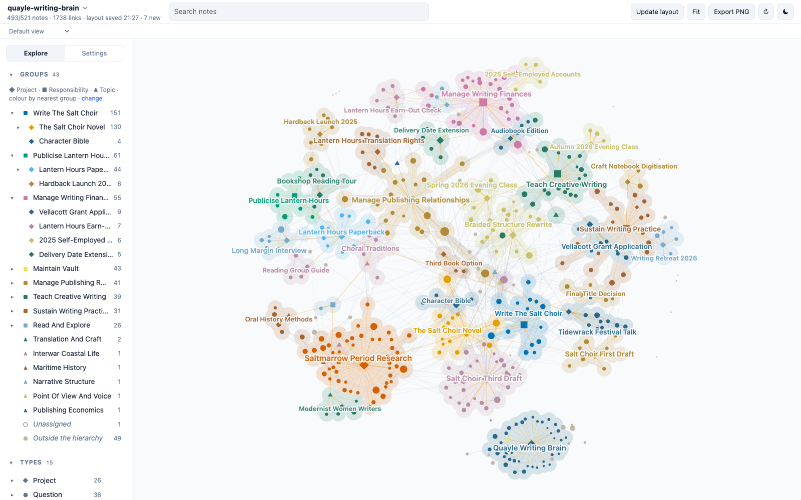

# Quayle Writing Brain

A demo Second Brain: about 500 linked Markdown notes holding the working memory of a fictional novelist writing her second book while her first comes out in paperback. Clone it, open the folder, and explore what a vault looks like after two years of daily use: projects, decisions, meetings, people, reading, open questions, and the links between them.



> [!warning]
> Everything about the novelist is fictional: Hester Quayle, her books, the town of Saltmarrow, every person, the publisher, agency, festival, magazine, bookshops, college, fund, residency and archive. Any resemblance to real people or organisations is accidental. Only the Sources marked as Wikipedia articles, public-domain literary works or documentation are real.

## What it shows

The vault was deployed from the [Second Brain template](https://github.com/mfoll/second-brain-template), which adds operating rules, workflows and a decision record to the [Portent](https://github.com/refactoringhq/portent) note model. Everything is plain files: Markdown notes with YAML frontmatter, typed relationships (`belongs_to`, `related_to`, `has`) and wikilinks. No app, database or index is required.

| Area | What to look at |
| --- | --- |
| Structure | 7 Responsibilities at the root, about 25 Projects under them, 9 Topics as lateral context; every note rolls up to a Responsibility. |
| Memory | About 180 Sources, 50 Events, 35 Questions, 30 Concepts, 15 Opinions, 15 Recaps, 40 people. |
| Real material | About 60 Sources are real: Wikipedia articles on narrative technique, publishing and the 1920s, and public-domain novels, summarised in our own words. Their "Why It Matters" sections describe how the fictional novelist uses them. |
| Operations | `AGENTS.md`, Type notes, Procedures, Skills and ADRs from the template, unchanged except for the deployment steps. |
| History | Git history from January 2025 to October 2026, one commit per month of captures. |

## Open it

- **Any Markdown editor.** Clone the repository and open the folder. Start from [[vault]].
- **[Tolaria](https://tolaria.md/).** Open the folder as a vault for typed sidebars, relationship panels and saved views.
- **[Brain Graph](https://github.com/mfoll/brain-graph).** See the whole vault as a map coloured by project:

  ```bash
  npx github:mfoll/brain-graph path/to/second-brain-demo-novelist
  ```

- **A coding agent.** Run Claude Code, Codex or Gemini CLI in the folder. They read [[AGENTS]] (through `CLAUDE.md` and `GEMINI.md` where needed) and follow the vault's Procedures.

## Try this

Each question has a known answer in the vault, so you can check what an agent finds.

| Ask | Where the answer lives |
| --- | --- |
| Why did I abandon the braided structure of The Salt Choir? | Only partly abandoned: decided on 2026-02-19, partly reversed on 2026-07-08, and the agent still disagrees about the prologue. See [[braided-structure-rewrite]] and [[salt-choir-structure-history]]. |
| When is the next Salt Choir advance payment due, and why did it move? | It follows the delivery date, moved after the rewrite. See [[delivery-date-extension]] and [[cash-flow-forecast-2026]]. |
| Would Saltmarrow's lifeboat have had an engine in 1927? | An archive visit and a student settled it. See [[would-saltmarrows-lifeboat-have-had-an-engine-in-1927]]. |
| Where did the idea of Constance's letters come from? | An evening class exercise. See [[constance-leal]] and [[class-session-2026-01-27]]. |
| Has Lantern Hours earned out its advance? | See [[lantern-hours-earn-out-check]] and [[lantern-hours-royalty-statement-2026-10]]. |
| Should I take the Ashlar translation commission? | Still open. See [[should-i-take-the-ashlar-translation-commission]]. |

Workflows to try with an agent:

- **Resume a project:** "Resume the Salt Choir third draft."
- **Process the Inbox:** about eight raw captures from the last weeks of October 2026 have `_organized: false`; each has an obvious home.
- **Ingest a source:** give any Wikipedia article on a narrative technique or on 1920s coastal life and ask where it belongs.
- **Lint the vault:** the audits report what a vault kept by hand accumulates, such as parentless external contacts.

## Scope and privacy

The fictional novelist's second novel, the debut's publicity, her agent and editor, teaching, writing finances, practice and reading. No family, health or personal administration, no bank or tax identifiers, and no student writing beyond short phrases quoted with consent; contracts, statements and recordings are pointers to where the documents are kept.

## Template updates

The vault was deployed from the template on 2026-10-23. Later template improvements can be ported with [[upgrade-existing-vault-from-template|Upgrade an Existing Vault From the Template]], as a reviewed change: an agent proposes each port, and a person approves it. Never run it unattended. A vault in use is expected to differ from the template on purpose, in its ADRs, Procedures, Skills and instructions.

## How it was made

An AI agent drafted the world specification (the novelist, people, projects, timeline and the storylines behind the questions above) and a person reviewed and changed it. AI agents then wrote the notes from it, one per area of her work, and retrieved the real articles from Wikipedia. The links, frontmatter, cross-area consistency and source metadata were checked with the template's lint scripts and against Wikipedia.

## Storage and backup

Git history in this repository. A demo that edits notes can be reset with `git checkout .` and `git clean -fd`.

## More example vaults

This is one of nine fictional vaults deployed from the same template, each kept by a different kind of person: a lab head, a café owner, a teacher, a freelance designer, a parent running a household, a sports club chair, a novelist, a start-up engineering lead and an HR assistant. The [template README](https://github.com/mfoll/second-brain-template#example-vaults) lists them all.

## Licence

MIT, see `LICENSE`, which also covers the template material. `THIRD_PARTY_NOTICES.txt` lists upstream notices. Cited articles and works remain under their own licences; the notes contain only their metadata and our own summaries.
